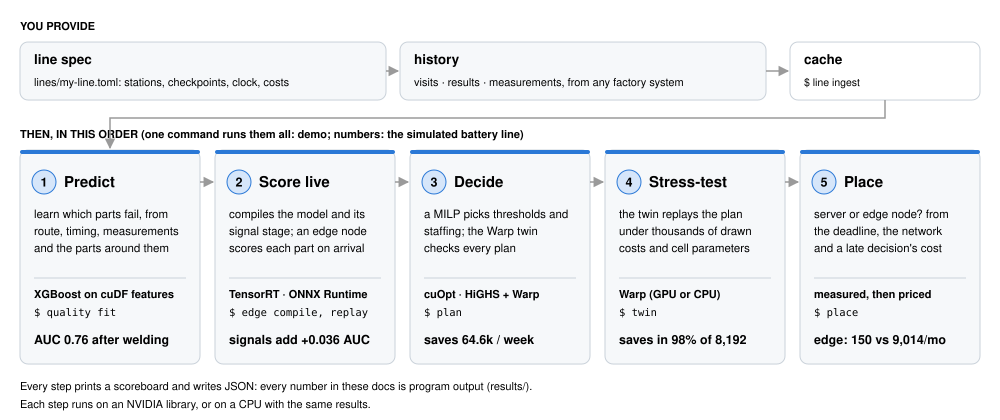
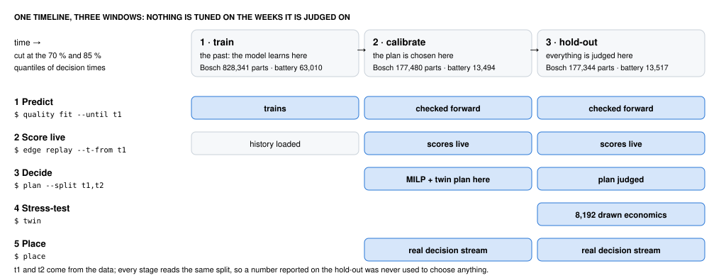
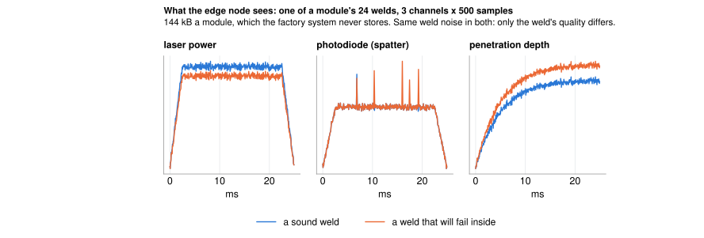
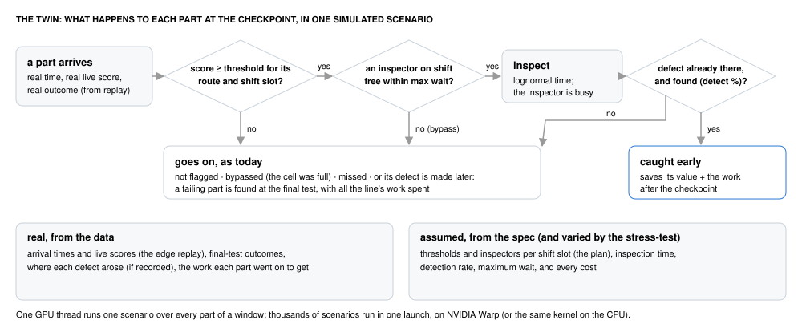
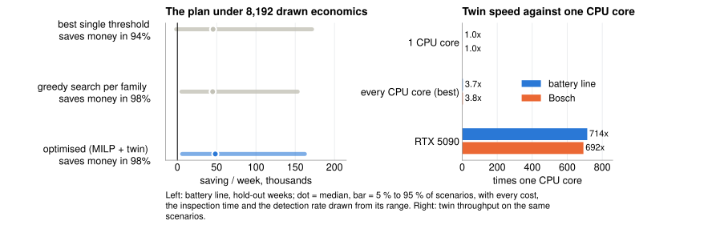
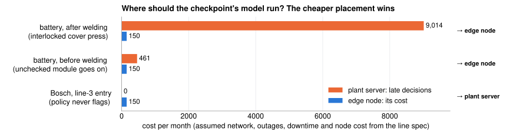
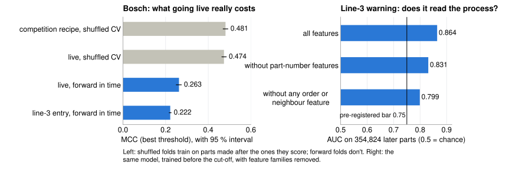
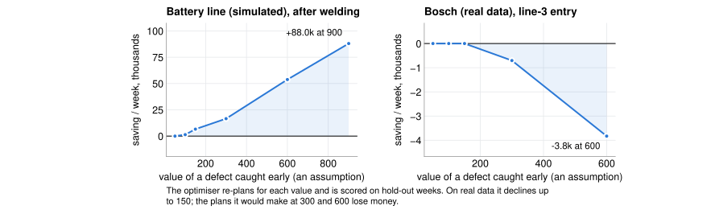

# Line Loop

**A deployable, end-to-end demo of NVIDIA's GPU software applied to a real industrial edge problem: catching bad
parts on a production line early, deciding whether catching them pays, and making that decision at the line.**

Line Loop takes NVIDIA's stack (RAPIDS, XGBoost, TensorRT, Warp and cuOpt) from training on a GPU server to live
scoring on an edge node next to the machines. It works for any line described in a short config file, was tested
on 1.18 million real parts from Bosch, and falls back to an ordinary CPU at every step.

- **MCC 0.481** predicting failures on Bosch's real production data, near the Kaggle competition's silver-medal
  cut-off (MCC: 0 = guessing, 1 = perfect)
- **Bit-for-bit identical** live and training features on 354,824 real parts: proof the live system never uses
  information from the future
- **0.05 ms** per prediction with TensorRT, and one compiled engine that reads the machines' raw sensor signals
- **Packaged for three targets:** a GPU server (verified on an RTX 5090), and edge-node containers for NVIDIA Jetson
  and x86



## The industrial edge problem

Take a factory that builds EV battery modules. Each module moves down a line of stations: the cells are sorted,
glued and stacked, metal connectors are laser-welded on, the cover is closed, and a final electrical test checks
the result. About 3 in 100 modules fail that test. By then the factory has spent every station's work on a part
that will be scrapped.

If you could tell that a module was probably bad **right after welding**, you could pull it aside and fix the weld
while the cover is still off. That's cheap. Finding it at the end means scrapping a finished module. That's
expensive.

That raises four questions, and Line Loop answers each of them for any line:
1. Can we predict which parts will fail, partway down the line?
2. Can we make that prediction live, as each part arrives, using only what is known at that moment?
3. Does pulling risky parts for inspection actually save money, once inspectors and waiting time are paid for?
4. Should the prediction run on a central server, or on a small computer next to the machines?

It's an edge problem because the decision has to be made at the line, within seconds of a part arriving. Some of
the data it needs, such as the welders' raw waveforms, never leaves the machine, and the decision has to keep
working when the plant network doesn't.

## The NVIDIA software, and what each piece does here

| NVIDIA software | its job in this system | stage | runs on | without a GPU |
|---|---|---|---|---|
| **RAPIDS cuDF** | builds the feature tables for 1.18 million parts | 1 Predict | GPU server | pandas, same result |
| **XGBoost on CUDA** | trains the failure-prediction model | 1 Predict | GPU server | XGBoost on CPU |
| **TensorRT** | runs the compiled model, raw-signal processing included, as one engine | 2 Score live | edge node (Jetson or RTX) | ONNX Runtime |
| **Warp** | the twin: thousands of simulations of the inspection station in one launch | 3 Decide, 4 Stress-test | GPU server | Warp on CPU |
| **cuOpt** | solves the inspection plan (which parts to pull, how many inspectors) | 3 Decide | GPU server | HiGHS |

Each was measured, not assumed:
- **Warp** is where the GPU matters most: about 190× every core of the CPU.
- **cuOpt** beats the free solver only at plant scale: 256 lines sharing one inspection crew.
- **cuDF and XGBoost** make iteration fast, and they don't change any result.
- **TensorRT** turns the model and the signal processing into one deployable engine. Raw speed isn't what it's
  needed for, since one CPU core also keeps up with the line.

## How it works: one part's journey

The program runs in six stages, always in the same order. One command (`demo`) runs them all.

**0 · Describe the line.** You write a short config file listing the stations in order, where you want to check
parts (the *checkpoint*, here just after welding), and your costs: what an inspection costs and what catching a
bad part early saves. You also export the line's history as three plain tables any factory system can produce:
which part was at which station and when, which parts failed the final test, and what the stations measured. No
code is written per factory: that's what makes it a framework rather than a one-off script.

**1 · Predict.** The program learns from the history which parts tend to fail. For each part it builds a
description: how long it spent at each station, what the stations measured, and what happened to the parts made
just before and after it (bad parts often come in batches). A standard machine-learning model, **XGBoost**,
learns from those descriptions. It's hundreds of small decision trees (1,300 on Bosch), each correcting the ones before it. This
is the only part of the system that learns. Everything after it either runs this model or acts on its predictions.

The care here is about time. A prediction made when a part reaches the welder must not use anything that happens
later; a model that peeks at the future looks brilliant in testing and fails in a real factory. So the history is
cut into three windows: the model learns on the first, the inspection plan is chosen on the second, and everything
is judged on the third, which nothing was tuned on.



**2 · Score live.** In a real factory, parts arrive one at a time. So an **edge node**, a program that would run
on a small computer at the line, receives the factory's events one by one ("part 1042 started", "part 1042 reached
the welder", "part 998 failed its test"). It keeps track of what it has seen and scores each part as it arrives.
The live features it computes are compared with the ones the model was trained on, and they are identical, bit for
bit: on real Bosch data, for all 354,824 parts. That proves the training never used information a live system
wouldn't have.

To run fast anywhere, the trained model is compiled into a form NVIDIA's **TensorRT** runs in about 0.05 ms per
part on a GPU; the same file runs on any CPU. The welders also record waveforms during every weld (laser power,
spatter, penetration depth: 144 kB per module) that factories usually throw away. Only a computer at the welder
can see them. The compiled model reads them directly, and on the battery line they make the prediction better
(AUC from 0.726 to 0.763, where 0.5 is guessing and 1 is perfect).



**3 · Decide.** A prediction alone saves nothing. Acting on it costs inspector time, and parts waiting for an
inspector slow the line. Two tools work together here:
- an **optimiser** (NVIDIA **cuOpt**, or the free **HiGHS** on a CPU) works out, for each type of part and each
  shift, how risky a part must be before it is pulled, and how many inspectors to staff. It weighs wages against
  the savings from defects caught early;
- the **twin** checks that plan. It's a simulation of the inspection station run over the line's real stream of
  parts. For each part it asks: is it risky enough to pull? Is an inspector free, or would it wait too long? Does
  the inspection find the defect, and did the defect even exist yet at that point? NVIDIA **Warp** runs thousands
  of these simulations at once on the GPU. If the plan overloads the inspectors, the optimiser tightens it and
  tries again.



**4 · Stress-test.** The costs are guesses: what an inspector costs, how often they find a defect, what a caught
defect is worth. So the twin replays the plan 8,192 times with every guess varied at random. On the battery line
the plan still saves money in 98 % of those runs. The GPU does this about 190 times faster than every core of the
CPU together.



**5 · Place: server or edge node, and how it decides.** Speed doesn't decide this: even one ordinary CPU core
scores a module, weld waveforms included, in 0.12 ms. What decides it is what happens when a decision arrives
late. Line Loop replays the real sequence of parts reaching the checkpoint and simulates both options:
- **on a server**, each part's data travels over the factory network. It queues for the link (the weld waveforms
  make each module 145 kB), takes a round trip there and back, and during a network outage it waits until the
  network returns;
- **on an edge node** next to the machines, only the computation counts, so outages don't matter.

Every decision that misses its deadline then costs what the line does without one. Either the part goes on
unchecked, losing the saving the plan would have made, or, if the next machine is interlocked, the line stops and
waits. Over a month: the server's cost is its late decisions, the edge node's cost is the box. The cheaper one
wins. After welding, the cover press won't close a module without a decision, so two half-hour outages a month
would stop the line on a server, costing about 9,000 a month against 150 for an edge node. On Bosch, where the plan
never pulls a part, a late decision costs nothing and a server is enough. The network speed, outages and costs
are written in the line's config file, so you can change them and watch the answer change.



## What it found

**On real data: Bosch.** In 2016 Bosch published data from one of its production lines as a Kaggle competition:
1.18 million parts, 52 stations, 0.58 % failing. Line Loop reaches **MCC 0.481** in the competition's own testing
setup, near the silver-medal cut-off (0.471; no submission was made). The more important findings:
- **Going live costs a lot of accuracy, and the standard test hides it.** The competition's testing method mixes
  past and future parts. Tested the realistic way (trained on the past, scored on later parts), the live model's
  MCC is 0.263. Scores reported the competition's way don't show that drop.
- **The model reads the process, not just the part numbers.** With every feature about part order and neighbouring
  parts removed, the early warning keeps most of its power (AUC 0.864 → 0.799).
- **The right answer is "don't inspect early".** The warning isn't precise enough for inspections to pay under the
  assumed costs, and the optimiser says so. A simpler search on the same weeks found a plan that looked good and
  then **lost 7,345 a week** on later weeks.



**On a simulated line: battery modules.** There was no real battery-factory data, so the program generates a
realistic history from the line's config file. That shows the framework running unchanged on a line unlike Bosch,
and it exercises what Bosch can't, such as raw weld waveforms. The inspection plan saves 64,600 a week on weeks it
never saw. That's about the same as simpler policies, not better. Because the costs are assumptions, these numbers
show the machinery working, not a real factory's savings.



## Deploying it: what runs where

Every stage is a command in one Python package (`python -m lineloop ...`), so the same code deploys in three
places. The model is trained on the server and compiled once to an ONNX program. The TensorRT engine is then
built on whichever GPU it lands on. Models and data are mounted into the containers, never baked in.

| target | what runs there | how | status |
|---|---|---|---|
| **GPU server or workstation** (RTX or data-centre GPU) | everything: features, training, compiling, the twin, the optimiser | [`deploy/vm/setup.sh`](deploy/vm/setup.sh) installs the pinned NVIDIA stack | verified on an RTX 5090 |
| **Edge node on NVIDIA Jetson Orin** | the live edge node: the factory's events in, the TensorRT engine built on the device, decisions out | [`deploy/jetson/Dockerfile`](deploy/jetson/Dockerfile) | written; not run (no Jetson was available) |
| **Edge node on an x86 box**, with or without a GPU | the same edge node on TensorRT or ONNX Runtime | [`deploy/x86/Dockerfile`](deploy/x86/Dockerfile) | written; not built here |

Details: [Deploying](deploy/README.md).

## Why this design

The aim is to show NVIDIA's software doing a real job end to end, not in isolated benchmarks: data preparation,
training, compiled inference at the edge, simulation and optimisation, each where it belongs and packaged to
deploy. A model tuned for one dataset would have shown one library. So Line Loop is a framework: any line's config
and history go in, and a deployment decision comes out.

A later review of the whole project found real problems:
- the simulation gave the inspection station credit for catching defects that hadn't happened yet, which
  overstated the savings about fourfold;
- the standard testing method hid most of the live accuracy drop;
- parts of the code did nothing useful.

All of them were fixed, and the corrected numbers are the ones published here. Every check on the real data was
written down before the run that tested it, and failed checks stay failed ([checks](docs/PLAN.md),
[results](results/RESULTS.md)).

## Limits

Line Loop is a deployable demo, not a finished product:
- **Connectors and operations.** It reads exported factory data and replays it as a live event stream. A plant
  installation would also need a connector to the line's equipment (OPC UA or MQTT), an operator screen, and
  automatic retraining.
- **Hardware.** The GPU-server path is verified end to end. The edge containers are written but have not run on a
  Jetson; one CPU core already keeps up, so the edge results don't depend on it.
- **Assumptions and simulation.** The costs and network figures are assumptions. The battery line and its weld
  waveforms are simulated, and only the Bosch study is real data.

## Try it

You need Python 3.10 or newer. No GPU, data or account is needed: the battery line is simulated from its config.

```bash
git clone https://github.com/daniel-debrun/lineloop.git
cd lineloop
python -m venv .venv
.venv/bin/pip install -e .
.venv/bin/python -m lineloop demo --line battery-module --parts 20000
```

The output is labelled "0 · Load" through "5 · Place" in the order above, and ends with a summary. Read
[`lines/battery-module.toml`](lines/battery-module.toml) alongside it: every number the program uses comes from
that file or the data. With the Kaggle data, `--line bosch` runs the real study
([how](docs/BOSCH_STUDY.md#reproducing-it)).

## Going deeper

| | |
|---|---|
| [How Line Loop works](docs/HOW_IT_WORKS.md) | every stage in depth: the model, the edge node, the twin, the optimiser, placement, the tests |
| [Describing a line](docs/LINE_SPEC.md) | the config file and data formats, and how to add your own line |
| [The Bosch study](docs/BOSCH_STUDY.md) | the real-data results, what is real and what is assumed |
| [Deploying](deploy/README.md) | GPU workstation setup, Jetson and x86 containers |

The Bosch data belongs to Bosch and Kaggle and is not included. Code licence: Apache-2.0.
