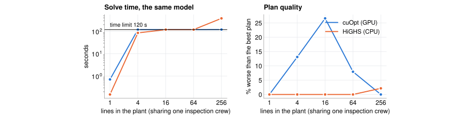

# How Line Loop works

Line Loop takes a production line from its history to a deployment decision in six stages, always run in the same
order. This page explains each stage the same way:
- the question it answers;
- the command that runs it, and what it reads and writes;
- the model or method inside it;
- how it is checked;
- what it measured, on the real Bosch line and on the simulated battery-module line.

Every number here comes from the committed results in [`results/`](../results).

**Contents:** [the pipeline](#the-pipeline-in-run-order) · [the time split](#one-timeline-three-windows) ·
[the models](#the-models-and-methods-at-a-glance) · [0 load](#stage-0--describe-and-load-the-line) ·
[1 predict](#stage-1--predict) · [2 score live](#stage-2--score-live) · [3 decide](#stage-3--decide) ·
[4 stress-test](#stage-4--stress-test) · [5 place](#stage-5--place) · [GPU and CPU](#gpu-and-cpu) ·
[tests](#what-the-tests-guarantee) · [limits](#limits)

## The pipeline, in run order

`python -m lineloop demo --line <spec>` runs these in order; each is also a command of its own.

| # | stage | question | command | reads → writes |
|---|---|---|---|---|
| 0 | **Load** | what is this line, and is its data consistent with it? | `line show`, `line simulate`, `line ingest` | spec + three tables → cache (`stations.parquet`, `numeric.parquet`, `line.json`) |
| 1 | **Predict** | which parts will fail, and how well can that be known in advance? | `quality cv`, `quality fit` | cache → `summary.json` (CV), `model.json` + `model_card.json` |
| 2 | **Score live** | can the model run where the data is, and see only the past? | `edge compile`, `edge bench`, `edge replay` | model → `model.onnx` (+ TensorRT engine); cache → `scored.parquet` |
| 3 | **Decide** | which parts should be pulled, by how many inspectors, and does it pay? | `plan` | scored parts → `plan.json` (policy, hold-out results, break-even) |
| 4 | **Stress-test** | does the plan still pay if the assumptions are wrong? | `twin` | scored parts + plan → `sweep.json` |
| 5 | **Place** | should the model run on a plant server or at the cell? | `place` | model + plan + decision stream → `place.json` |

Each command prints a scoreboard and writes JSON. `python -m lineloop report --collect` copies the aggregate
JSON into `results/`, and [`tools/figures.py`](../tools/figures.py) draws every figure from there.

## One timeline, three windows

The history is cut by decision time into a training window, a calibration window and a hold-out window, at the
70 % and 85 % quantiles. Every stage respects the same cut, so nothing reported on the hold-out was used to choose
anything.

## The models and methods at a glance

| inside | what it is | learned or fixed | where |
|---|---|---|---|
| **failure model** | gradient-boosted decision trees (XGBoost, binary logistic loss, `hist` method). Bosch line-3 entry: 1,300 trees of depth 8 on 970 features; battery post-weld: 200 trees on 183 features. | learned | [`quality/train.py`](../lineloop/quality/train.py) |
| **features** | a part's own timing, route and measurements, plus what is known about the parts made around it (order, batches, their results), masked to the decision time | fixed rules | [`quality/features.py`](../lineloop/quality/features.py) |
| **signal stage** | fixed signal processing on raw waveforms (window means, high-pass energy via a 5-tap convolution, summaries over a part's welds): 27 features from 144 kB | fixed | [`edge/signals.py`](../lineloop/edge/signals.py) |
| **compiled program** | the trees padded to perfect binary trees and rewritten as tensor operations (gathers and comparisons), with the signal stage in front; run by TensorRT or ONNX Runtime | compiled from the model | [`edge/compile.py`](../lineloop/edge/compile.py) |
| **edge node** | an event-driven state machine: it keeps start order, decision order, group counts and known results, and builds each part's features from those alone | not a model | [`edge/stream.py`](../lineloop/edge/stream.py) |
| **twin** | a discrete-event simulation of an inspection cell at the checkpoint: a multi-server queue with lognormal inspection times, a wait limit and a detection rate, over the real stream of scored parts; one GPU thread per scenario | not learned; its parameters are the plan and the spec's assumptions | [`twin/inspection.py`](../lineloop/twin/inspection.py) |
| **optimiser** | a mixed-integer linear program: which share of each route family to flag in each shift slot, and how many inspectors per slot; capacity must hold in every calibration week | solved (cuOpt or HiGHS) | [`optimize/inspection.py`](../lineloop/optimize/inspection.py) |
| **stress-test** | Monte Carlo over nine assumptions, each drawn log-uniformly from a range around its value | sampled | [`twin/robust.py`](../lineloop/twin/robust.py) |
| **placement** | Monte Carlo of the network: a first-come-first-served uplink, log-normal round trips, Poisson outages; then a monthly cost per placement | sampled | [`edge/place.py`](../lineloop/edge/place.py) |

Only the failure model is learned from data. Everything after it either runs that model faithfully (the compiled
program, the edge node) or uses its scores to make and test a decision (the twin, the optimiser, the stress-test,
placement).

## Stage 0 · Describe and load the line

> **Question:** what is this line, and is its data consistent with it?

| | |
|---|---|
| commands | `line show --line S` · `line simulate --line S` (only for a spec with `[simulate]`) · `line ingest --line S` |
| reads → writes | the spec and three tables (visits, results, measurements) → the cache |
| method | an adapter per data format: generic event tables, or the Kaggle Bosch CSVs |

**The spec** ([Describing a line](LINE_SPEC.md)) gives:
- the segments and their stations in flow order;
- the checkpoints, where a part may be scored before the end;
- the clock (hours per data unit and its resolution) and the shifts;
- the assumed costs and inspection cell, and how uncertain they are;
- optionally, the raw signals stations record, the network at each checkpoint, and how to simulate a history.

**The cache** holds, per part, the first and last time at each station, its final-test result if known (and where
its defect arose, if the data says), and its measurements. It also holds `line.json`, the spec resolved against
the data. Every later stage reads only the cache, so no stage knows which format the data came in, and a model
can never be paired with the wrong line.

**Checks:** the ingest stops on a station the spec doesn't list, and reports stations that never appear and
results for parts with no visits. A demo re-simulates a line whose spec has changed since its data was made.

## Stage 1 · Predict

> **Question:** which parts will fail the final test, and how well can that be known in advance?

| | |
|---|---|
| commands | `quality cv --recipe R [--split time]` · `quality fit --recipe R --until t1 [--drop REGEX]` |
| reads → writes | the cache → `summary.json` (scores, intervals, per fold) · `model.json`, `model_card.json` |
| model | XGBoost gradient-boosted trees |
| NVIDIA / CPU | cuDF + XGBoost on CUDA / pandas + XGBoost on CPU |

### When a part is scored: the decision time

Every part is scored at a **decision time D**. A *recipe* sets D and what may be known then:

| recipe | D | the part's own data | other parts |
|---|---|---|---|
| `offline` | its last timestamp | everything | everything, including parts made after it: the Kaggle setting, a benchmark only |
| `live` | its last timestamp | everything | only what existed at D |
| a checkpoint (e.g. `post-weld`) | when it reaches the checkpoint's station or a later one | only stations before the checkpoint, up to D | only what existed at D |

What is known about another part q at time D:
- its **start**, once q has started;
- its **route, end time and timestamp signature**, once q has been decided itself;
- its **final-test result**, once q has left the line.

A part's own data is cut at D too. A part sent back to an earlier station after the checkpoint keeps only its
first time there and loses its measurements there, which may come from the later visit.

The end-of-line recipes are a benchmark: at the end of the line the final test already has the answer. The
deployable models are the checkpoint ones.

### The features

| family | what | why |
|---|---|---|
| own timing | per station: time in, time since start, time spent; per segment: start, duration, stations visited; time of day and week | slow or unusual passages, shift effects |
| own route | stations visited; route and timestamp-signature keys for grouping | some routes fail more |
| own measurements | every measurement before D; how many were recorded; how many parts share exactly these values | the physics of the part |
| own signals | the signal stage's features for each raw signal recorded before D (stage 2) | what a station saw while it worked |
| order | gaps and number differences to the neighbouring parts in start order (`S_`), decision order (`E_`) and numbering order (`I_`) | parts made back to back share a process state |
| groups | how many parts share this part's start time, end time, signature, route, hour, day, and time at each busy station | batches |
| neighbour results | final-test results of nearby parts in each order, and known failures within each group | failures cluster in time: a bad batch, a drifting station |

### Leak controls

Neighbour results are features, so they must never reveal the scored part's own label:
- in cross-validation, the results of parts being scored are hidden, filled in per fold;
- group statistics count only members of *other* Id classes (Id mod 5), not "the group minus this part", because
  a leave-one-out sum lets a model read the part's label back. On Bosch that leak dropped fold AUC from 0.924 to
  0.896 before it was caught;
- a test flips each part's own label and requires none of its features to change.

### The model and how it is evaluated

XGBoost with fixed settings: depth 8, learning rate 0.03 (0.02 with 1,300 rounds on Bosch), 85 % row and 40 %
column subsampling, 256 histogram bins, a fixed number of rounds and no early stopping on the scored data. On the
GPU the matrix never leaves the device.

| evaluation | what it is | why |
|---|---|---|
| **shuffled CV** | 5 stratified, shuffled folds | how the Kaggle competitors scored; trains on parts made after the ones it scores |
| **forward CV** (`--split time`) | 6 consecutive blocks; each of the last 5 is scored by a model trained on the blocks before it | what a deployed model can expect |
| **forward check** (`fit --until t1`) | trained on window 1, scored on every later part | the deployable model's real test |
| **ablation** (`--drop`) | the same model without a family of features | what a family is really worth |

MCC (the competition's metric: 0 = chance, 1 = perfect) is reported at the best threshold and, more strictly, with
each fold's threshold taken from the other (or earlier) folds, with a bootstrap 95 % interval. AUC is reported too.

### Checks

- The live and checkpoint features are rebuilt independently by the edge node (stage 2) and must match exactly.
- cuDF and pandas build the same matrix cell for cell (1.15 billion cells on Bosch, 0 differences).
- The causal masks are checked against brute force on raw times; scored-fold labels never reach features.

### Results

| | Bosch (real) | battery (simulated) |
|---|---|---|
| benchmark: end of line, shuffled CV | MCC 0.481 [0.470, 0.492], AUC 0.921 | MCC 0.212, AUC 0.769 |
| live, end of line | shuffled MCC 0.474; **forward MCC 0.263** [0.250, 0.274] | |
| checkpoint model, forward check | line-3 entry: **AUC 0.864** on 354,824 later parts | post-weld: **AUC 0.763** on 27,011 later modules |
| ablation | 0.831 without part-number features; **0.799** without any order or neighbour feature | **0.726** without the raw weld signals |

Going live costs about 0.22 MCC on Bosch, which shuffled CV hides. The line-3 model keeps most of its power
without any order feature, so it reads the parts' own process data.

## Stage 2 · Score live

> **Question:** can the model run where the data is, seeing only the past, fast enough?

| | |
|---|---|
| commands | `edge compile --model M` · `edge bench --model M` · `edge replay --model M --t-from t1` |
| reads → writes | `model.json` (+ `signals.json`) → `model.onnx`, TensorRT engine; the cache (+ raw signals) → `scored.parquet` |
| method | a compiler from trees to tensor operations; an event-driven edge node |
| NVIDIA / CPU | TensorRT, cuML FIL, XGBoost on CUDA / ONNX Runtime, XGBoost on CPU |

### The compiler: trees as tensors

Tree ensembles are branchy code, which GPUs and TensorRT handle poorly. The compiler pads every tree to a perfect
binary tree of the ensemble's depth, so that inference becomes D rounds of the same few tensor operations over all
trees at once:
1. look up each node's feature and threshold (`Gather`);
2. compare the part's value with the threshold, sending a missing value to XGBoost's default side;
3. move to the left or right child.

A final sum of the leaf values gives the score. Only basic operators are used, so TensorRT builds an engine on
the device and ONNX Runtime runs the same program anywhere. Thresholds are never rounded, so the program takes
exactly XGBoost's branches; rows built to sit on split thresholds check it.

**The signal stage.** A model that uses a raw signal's features gets a second input, the part's raw block (battery
line: 24 welds × 3 channels × 500 samples). In front of the trees, the compiled graph computes per weld and channel
the mean of the middle 80 %, the high-frequency energy (the signal minus a 5-sample moving average, a fixed
convolution), and the mean of the last 5 %, then their mean, maximum and minimum over the welds. These features
are written into the model's columns. One TensorRT engine goes from raw waveforms to a score. TF32 is switched
off, so the result agrees with the NumPy reference to float32 rounding.

### The edge node

The node sees the line only as events, processed one clock tick at a time: a part **starts**, a part reaches the
**decision** point (its own data arrives with it, and it is scored), a part's **result** becomes known. Within a
tick, starts, then decisions, then results are registered before anything is scored. That's exactly the "known
by D" rule of stage 1. The node keeps incremental state (start and decision order, group counters, known results
per group and Id class) and never reads another part's data row.

**Parity is the point.** On every line and every live recipe, the node's feature rows must equal the batch matrix
bit for bit. If they do, the batch features use nothing a live system couldn't know, and stage 1's numbers are a
fair preview of live performance. The node can warm-start from history loaded in bulk; that gives the same rows
as replaying everything.

### Results

| | Bosch line-3 entry | battery post-weld |
|---|---|---|
| model | 1,300 trees × depth 8, 970 features, 4.3 MB ONNX | 200 trees × depth 8, 183 features (27 from the weld signal), 0.7 MB |
| compiled vs XGBoost, on threshold-boundary rows | max difference 1.8e-6 (TensorRT), 1.5e-6 (ONNX Runtime) | 3.9e-7, raw signal included |
| latency per part, batch 1 | TensorRT 0.052 ms; XGBoost on one CPU core 0.235 ms | TensorRT 0.09 ms; ONNX Runtime on one core 0.12 ms |
| live replay | 1.74 M events, 354,824 parts scored; features equal to batch bit for bit; same AUC (0.8644); 52.6 ms median per busy 6-minute tick, 118 ms p99 | 86,982 events, 27,011 modules; 0.37 ms median per tick; scores within 1.7e-3 of the history's (0.02 % of parts above 1e-4) |

## Stage 3 · Decide

> **Question:** which parts should be pulled for inspection, how many inspectors are needed in each shift, and
> does it pay?

| | |
|---|---|
| command | `plan --scored F --split t1,t2` |
| reads → writes | the live scores of windows 2 and 3 → `plan.json` (the policy, the loop, hold-out results, break-even) |
| method | a MILP, checked and corrected by the twin, then tested on the hold-out |
| NVIDIA / CPU | cuOpt and Warp / HiGHS and Warp on the CPU |

### The twin: what it simulates

The twin is a simulation of an inspection cell at the checkpoint, run over the real stream of parts. It doesn't
learn anything. It answers "if we ran this policy on these weeks, what would have happened?"

In detail, for each part in time order:
1. Its route family and the shift slot of its arrival select a threshold. A score below it means the part goes on.
2. A flagged part takes the first inspector free on that shift. If the wait would exceed the limit, it moves on
   uninspected (a **bypass**).
3. The inspection takes a lognormal time with the assumed mean and spread.
4. A failing part is **caught** with the detection probability, but only if its defect already exists at the
   checkpoint. Where the data records each defect's origin station, a defect made later can't be found. Without
   origins (Bosch), every failure counts as findable.
5. A caught part saves the value of an early catch plus the stations it would still have visited. Inspections,
   inspector hours and waiting cost money.

One GPU thread runs one scenario (a policy, a staffing plan, a random seed) over every part of a window, so
thousands of scenarios run in one launch. The same kernel runs on the CPU, and a line-by-line NumPy reference
checks it.

### The MILP

Built on the calibration window (window 2):
- **decisions:** for each route family *f* and shift slot *h*, one share *j* of parts to flag (0 to 15 %), as
  binary choices x[f,h,j]; and an integer number of inspectors c[h] per slot;
- **objective:** minimise inspections and inspector hours minus the value of defects caught early and the work
  saved. Defects are **expected** from the model's probabilities (one calibration factor for the window, and the
  share of failures already present at that score), not counted, because a cell holds only a handful of real
  failures and choosing by counts picks lucky cells;
- **capacity:** the inspection hours flagged in each slot must fit the slot's inspectors in **every** calibration
  week, not on average.

### The loop and the tests

The MILP plans on averages with a fixed inspection time; the twin replays its plan with random inspection times
and real bursts. In any slot where too many flagged parts would bypass, the capacity limit is tightened and the
MILP is solved again, until the twin agrees. The final policy is then compared on the **hold-out** window with:
- today: no early inspection;
- the best single threshold with constant staffing, found by brute force in the twin;
- the best threshold per family, found by greedy search in the twin.

All baselines are held to the same bypass target. A break-even sweep re-plans for several values of a defect
caught early, because that value is an assumption.

### Results

| | Bosch line-3 entry | battery post-weld |
|---|---|---|
| MILP | 1,932 binaries, 350 rows; cuOpt, 1 loop iteration (1.3 s) | 560 binaries, 70 rows; 2 iterations |
| optimised policy, hold-out | **declines**: never flags (0 / week) | **saves 64,604 / week** (± 1,856 over seeds); catches 108.7 of 252.4 findable defects a week; 4.3 % bypass |
| best single threshold | none | saves 66,214 / week |
| greedy per family | **loses 7,345 / week**: it fitted noise in the calibration weeks | saves 62,843 / week |
| break-even | at 300 and 600 per defect the plans lose 703 and 3,828 / week | pays from about 100 per defect |

On Bosch the early warning isn't precise enough for inspection to pay, and the optimiser says so where a search
overfits. On the battery line the MILP matches the search baselines within noise rather than beating them.

## Stage 4 · Stress-test

> **Question:** does the plan still pay if the assumptions are wrong, and what does the GPU buy here?

| | |
|---|---|
| command | `twin --scored F --plan P` |
| reads → writes | the hold-out window's scored parts and the plan's policies → `sweep.json` |
| method | Monte Carlo over the assumptions, in the twin; the same scenarios timed on GPU and CPU |
| NVIDIA / CPU | Warp on CUDA / Warp on the CPU, one process per core |

The cell and the money are assumptions, so each policy is replayed on the hold-out weeks under 8,192 (on a GPU)
draws of nine of them. Each assumption is drawn log-uniformly from a range around its value (the spec's
`[uncertainty]`): value per defect ×0.33 to ×3, detection ×0.67 to ×1.1 (capped at 99 %), inspection time ×0.6
to ×2, the other costs ×0.5 to ×2. Every policy sees the same scenarios and seeds. The report gives the share of
scenarios in which a policy saves money, the spread of its saving, its break-even value per defect, and which
assumption moves it most.

The same scenarios are then timed on the GPU, on one CPU core (Warp's CPU backend is single-threaded), and on every
core (the faster of one process per thread or per core), each run long enough to time.

| | Bosch | battery |
|---|---|---|
| optimised policy, saves money in | never flags: nothing to stress | **98 %** of 8,192 scenarios (median 48,300 / week); breaks even at about 150 per defect |
| other policies | the greedy policy loses money in all of them | single threshold 94 %, greedy 98 % |
| GPU vs one CPU core / the CPU's best | 692× / 182× | 714× / 192× |

## Stage 5 · Place

> **Question:** should the checkpoint's model run on a plant server or on an edge node at the cell?

| | |
|---|---|
| command | `place --model M --plan P` |
| reads → writes | the model, the plan and the line's real decision times at the checkpoint → `place.json` |
| method | compute measured here; a Monte Carlo of the network; a monthly cost per placement |

Speed rarely decides this: one CPU core keeps up with either line thousands of times over. What decides it is what
a decision needs from the cell, and what a late one costs. The line's real stream of decisions is played against:
- **a server:** each part's record, plus its raw signal if the model uses one, goes up a first-come-first-served
  uplink. A log-normal round trip and the compute follow. During a network outage (Poisson, exponential length),
  parts wait;
- **an edge node:** compute only. It sends features and decisions upstream when the network is up.

A decision later than the deadline costs what the spec says the line does without one. With `pass`, the part
goes on unchecked, and the plan's saving per part is lost. With `stop` (an interlocked gate), the line waits, at
its downtime cost. An edge node costs its monthly figure. The cheaper placement wins. The network, the deadline
and the costs are assumptions in the spec's `[edge]` table, so the verdict is a worked trade-off that changes when
they do.

| | battery post-weld | battery pre-weld | Bosch line-3 entry |
|---|---|---|---|
| without a decision, the line | stops (interlocked cover press) | goes on | goes on |
| late decisions on a server, per month | 46.7 (during outages) | 54 | 125 |
| their cost / an edge node's, per month | 9,014 / 150 | 461 / 150 | 0 / 150 (the policy never flags) |
| verdict | **edge node** | **edge node**, narrowly | **plant server** |

## GPU and CPU

`python -m lineloop doctor` shows which path each stage takes here.

| stage | NVIDIA path | CPU fallback | same results? |
|---|---|---|---|
| features | RAPIDS cuDF | pandas | yes, cell for cell |
| training | XGBoost on CUDA | XGBoost on CPU | same algorithm; within floating-point noise between runs |
| inference | TensorRT, cuML FIL, XGBoost on CUDA | ONNX Runtime, XGBoost on CPU | within 2e-6 of XGBoost; with a signal stage, float32 rounding |
| twin | Warp on CUDA | Warp on the CPU | the same kernel; both match the NumPy reference |
| optimiser | cuOpt | HiGHS | the same model; both optimal on one line's plan |

Where the GPU earns its place, measured:
- **Warp:** the stress-test, about 190× the CPU's best.
- **cuOpt:** at plant scale only. On the plan grown to 256 lines sharing a crew (489,000 binaries), it finds a
  2.2 % better plan than HiGHS in a third of the time; up to 64 lines, HiGHS is faster or better (`lineloop
  solvers`).
- **cuDF and XGBoost on CUDA:** iteration speed on 1.18 M parts; they change no result.
- **TensorRT:** one engine from raw signal to score, the same program as on ONNX Runtime. Speed isn't what
  justifies it: one CPU core keeps up with the battery line.

## What the tests guarantee

`python -m pytest`: 61 tests, all on simulated lines, so they run without any real data. The 9 in `test_gpu.py`
need cuDF and TensorRT, and skip without them.

| file | stage | guarantees |
|---|---|---|
| [`test_line.py`](../tests/test_line.py) | 0 | specs parse and fail with specific messages; the events adapter handles date-times, string serials and unlabelled parts; both adapters carry failure origins; the simulated failure rate is the spec's |
| [`test_quality.py`](../tests/test_quality.py) | 1 | every recipe builds; causal masks match brute force; scored-fold labels and a part's own label never reach its features; CV finds the planted signal |
| [`test_edge_compile.py`](../tests/test_edge_compile.py) | 2 | the tensor program takes XGBoost's branches exactly, missing values included |
| [`test_edge_signals.py`](../tests/test_edge_signals.py) | 2, 5 | the ONNX signal stage equals the reference; a compiled post-weld model scores raw blocks as the trained model scores the history; the placement verdict follows its costs |
| [`test_edge_stream.py`](../tests/test_edge_stream.py) | 2 | the live node equals the batch matrix bit for bit, on both lines and every live recipe; warm start changes nothing; rework after D is cut in batch and live alike |
| [`test_twin.py`](../tests/test_twin.py) | 3, 4 | the kernel equals the NumPy reference (8 h and 12 h shifts); defects and flags are conserved; defects made after the checkpoint are never caught; every core gives the same answer as one; the stress-test's signs are right |
| [`test_optimize_inspection.py`](../tests/test_optimize_inspection.py) | 3 | the MILP prefers the risky family, staffs for it, never flags when nobody is on shift, holds capacity every week; the loop tightens until the twin keeps up |
| [`test_gpu.py`](../tests/test_gpu.py) | 1, 2 | cuDF builds exactly the pandas matrix for every recipe of both lines; TensorRT runs the signal stage |

## Limits

- **One final test, one label.** Line Loop predicts pass or fail at the end of the line, not per-station defect
  codes.
- **Flow order is linear.** Parallel machines are listed one after another; a line whose parts run sections in
  different orders needs one spec per order.
- **Repeat visits are collapsed** to a first and last time per station, and at a checkpoint to what happened
  before D.
- **Costs, the cell and the network are assumptions.** Read the break-even, stress-test and placement tables as
  trade-offs, not forecasts.
- **Never run on a Jetson** (none was available). The engine is built on the device from the same ONNX program
  verified on an RTX 5090, and one CPU core already keeps up, so the edge claim doesn't rest on it.
- **Raw signals are simulated**; there is no input format for recorded waveforms yet.
- **Simulated lines are fixtures, not twins of real plants.** They show the framework runs and what each stage
  recovers; only the Bosch study is real data. What a simulated line shows depends on how it was set up: when
  signal-only defects were 2 % of the battery line's failures, the raw signals added nothing, and the demo said so.
- **Not built:** an event transport (OPC UA, MQTT), retraining and drift monitoring, an operator interface with a
  reason per flag.
